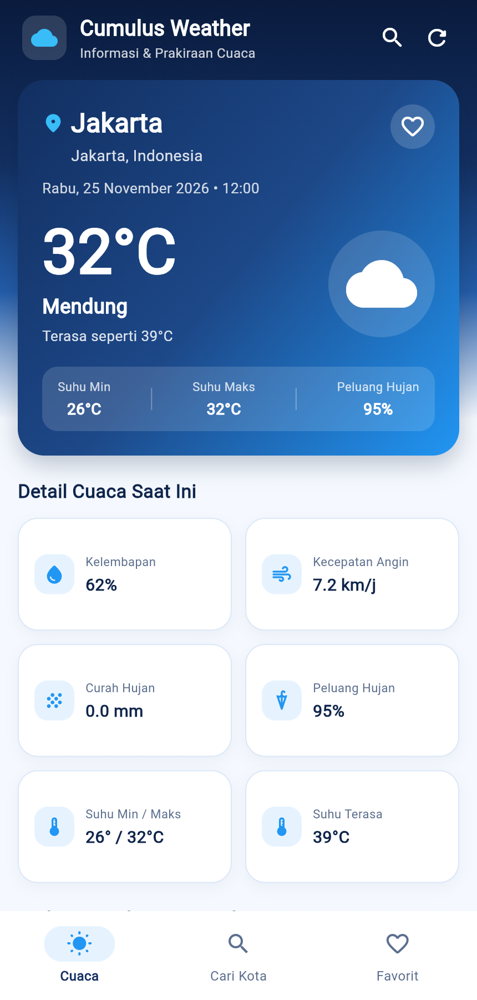
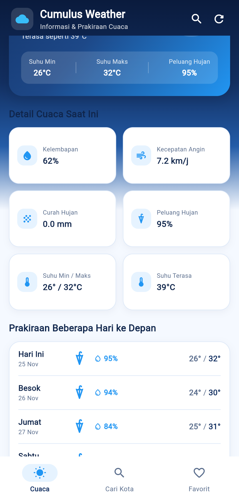
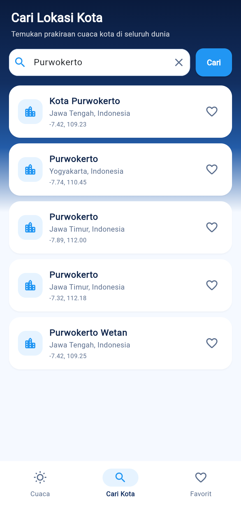
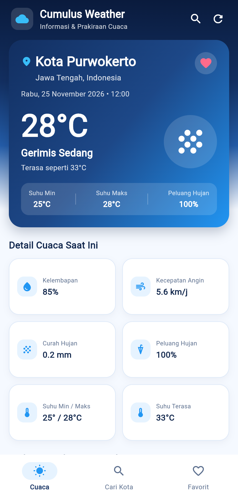
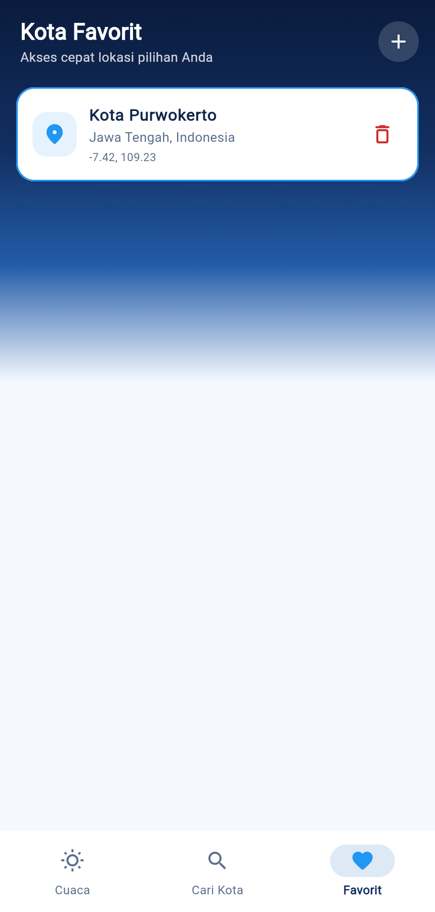

# Cumulus Weather — Aplikasi Informasi dan Prakiraan Cuaca Berbasis Flutter

## 1. Identitas Mahasiswa

- **Nama Mahasiswa**: Fikry Mumtaz Pratama
- **NIM**: H1D024106
- **Tugas**: Responsi 2
- **Nama Aplikasi**: Cumulus Weather
- **Repositori GitHub**: `H1D024106-FikryMumtazPratama-Responsi2-CumulusWeather`

---

## 2. Judul Proyek

**Cumulus Weather — Aplikasi Informasi dan Prakiraan Cuaca Berbasis Flutter**

---

## 3. Deskripsi Aplikasi

**Cumulus Weather** adalah aplikasi seluler berbasis Flutter yang menyajikan informasi cuaca terkini dan prakiraan cuaca beberapa hari ke depan secara langsung (*real-time*) menggunakan **Open-Meteo API**. Aplikasi ini mengusung konsep desain **BMKG Modern + Cloud Weather** dengan dominasi warna biru navy, biru langit sebagai warna utama, putih sebagai warna pendukung, serta latar belakang gradasi biru yang lembut.

Aplikasi dibangun menggunakan pola arsitektur **MVC (Model-View-Controller)** dengan pemisahan lapisan Layanan (*Service*) untuk komunikasi HTTP dan penyimpanan lokal menggunakan `SharedPreferences`.

---

## 4. Teknologi yang Digunakan

- **Kerangka Kerja**: Flutter (`3.47.8`)
- **Bahasa Pemrograman**: Dart (`3.13.7`)
- **Arsitektur**: MVC (Model-View-Controller) + Lapisan Layanan (*Service*)
- **API Cuaca & Lokasi**: Open-Meteo Weather Forecast API & Open-Meteo Geocoding API
- **Antarmuka**: Material Design 3 (`ThemeData`)
- **Paket (*Package*)**:
  - `http` (`^1.6.0`) — komunikasi HTTP GET ke Open-Meteo API
  - `shared_preferences` (`^2.5.6`) — penyimpanan daftar lokasi favorit secara lokal
  - `intl` (`^0.20.3`) — pemformatan tanggal dan waktu lokal Indonesia (`id_ID`)

---

## 5. Fitur Aplikasi

1. **Halaman Cuaca Utama (Halaman Beranda)**
   - Menampilkan nama kota dan negara yang dipilih.
   - Menampilkan tanggal dan waktu aktual dari lokasi tersebut.
   - Menampilkan suhu saat ini, suhu terasa (`apparent_temperature`), kondisi cuaca terkini, dan ikon cuaca dinamis.
   - Menampilkan detail kelembapan udara, kecepatan angin, curah hujan, peluang hujan, serta suhu minimum dan maksimum.
   - Mendukung tarik layar untuk menyegarkan data dan tombol tambah/hapus favorit langsung.

2. **Prakiraan Cuaca Harian**
   - Menampilkan prakiraan cuaca beberapa hari ke depan (7 hari).
   - Menampilkan nama hari, tanggal, ikon kondisi cuaca, peluang hujan (`%`), suhu minimum, dan suhu maksimum.

3. **Pencarian Lokasi Kota (Halaman Cari Kota)**
   - Pencarian kota secara langsung melalui Open-Meteo Geocoding API.
   - Menampilkan daftar hasil pencarian beserta wilayah administratif, negara, dan koordinat.
   - Memilih kota untuk langsung memperbarui tampilan cuaca di halaman utama.
   - Menambahkan atau menghapus kota dari daftar favorit langsung dari hasil pencarian.

4. **Daftar Kota Favorit (Halaman Favorit)**
   - Menampilkan daftar kota favorit yang tersimpan secara lokal menggunakan `SharedPreferences`.
   - Memilih kota favorit untuk menampilkan data cuaca kota tersebut.
   - Menghapus kota dari daftar favorit.
   - Data favorit tetap tersimpan meskipun aplikasi ditutup dan dibuka kembali.

5. **Penanganan Kesalahan & Pemuatan Data**
   - Menangani kondisi memuat data, koneksi internet terputus, server gagal diakses, masukan pencarian kosong, kota tidak ditemukan, dan daftar favorit kosong dengan pesan berbahasa Indonesia yang jelas.

---

## 6. Struktur Folder

```text
lib/
├── main.dart
├── models/
│   ├── weather_model.dart
│   └── location_model.dart
├── controllers/
│   ├── weather_controller.dart
│   └── location_controller.dart
├── services/
│   ├── weather_service.dart
│   └── location_service.dart
├── views/
│   ├── main_screen.dart
│   ├── home_screen.dart
│   ├── search_screen.dart
│   └── favorite_screen.dart
├── widgets/
│   ├── weather_card.dart
│   ├── weather_details.dart
│   ├── forecast_card.dart
│   ├── weather_icon.dart
│   └── loading_widget.dart
└── theme/
    └── app_theme.dart
screenshots/
├── 01_home_screen.png
├── 02_forecast_screen.png
├── 03_search_screen.png
├── 04_selected_city_home.png
└── 05_favorite_screen.png
```

---

## 7. Penjelasan Arsitektur MVC

Aplikasi ini menerapkan pola **MVC (Model-View-Controller)** dengan tambahan **Service** untuk menjaga pemisahan tanggung jawab:

- **Model**: Mendefinisikan struktur data aplikasi dan mengonversi JSON dari API maupun penyimpanan lokal menjadi objek Dart.
- **Service**: Melakukan permintaan HTTP GET ke Open-Meteo API dan operasi baca/tulis pada `SharedPreferences`.
- **Controller**: Mengelola status aplikasi (data cuaca, status pemuatan, pesan kesalahan, hasil pencarian, lokasi aktif, dan daftar favorit), memanggil Service, serta memberi tahu View ketika terjadi perubahan data melalui `ChangeNotifier`.
- **View**: Menampilkan antarmuka pengguna berdasarkan data dari Controller dan meneruskan interaksi pengguna kembali ke Controller.

---

## 8. Penjelasan Model

1. **`lib/models/weather_model.dart`**
   - Berisi kelas `WeatherModel` dan `DailyForecast`.
   - Mengolah JSON `current` (`temperature_2m`, `relative_humidity_2m`, `apparent_temperature`, `precipitation`, `weather_code`, `wind_speed_10m`) dan `daily` (`time`, `weather_code`, `temperature_2m_max`, `temperature_2m_min`, `precipitation_probability_max`) menjadi objek Dart melalui `WeatherModel.fromJson`.
   - Menyediakan fungsi statis `getConditionName(int code)` untuk mengubah `weather_code` WMO menjadi deskripsi kondisi cuaca berbahasa Indonesia.

2. **`lib/models/location_model.dart`**
   - Berisi kelas `LocationModel` untuk merepresentasikan lokasi kota (`id`, `name`, `country`, `admin1`, `latitude`, `longitude`).
   - Menyediakan `fromJson`, `toJson` (untuk penyimpanan ke `SharedPreferences`), getter `subtitle`, dan metode `isSameAs` untuk membandingkan kesamaan lokasi.

---

## 9. Penjelasan View

1. **`lib/views/main_screen.dart`**: Kerangka navigasi utama dengan `NavigationBar` (3 tab: *Cuaca*, *Cari Kota*, *Favorit*) dan `IndexedStack` untuk menjaga tampilan antar tab.
2. **`lib/views/home_screen.dart`**: Menampilkan cuaca terkini, detail parameter cuaca, prakiraan harian, status pemuatan/kesalahan, serta dukungan tarik untuk menyegarkan data.
3. **`lib/views/search_screen.dart`**: Menyediakan kolom pencarian kota, tombol cari, daftar hasil pencarian dari Geocoding API, pemilihan kota, dan tombol favorit.
4. **`lib/views/favorite_screen.dart`**: Menampilkan daftar kota favorit yang tersimpan, mendukung pemilihan kota favorit dan penghapusan dari daftar.
5. **`lib/widgets/`**: Berisi komponen antarmuka modular (`weather_card.dart`, `weather_details.dart`, `forecast_card.dart`, `weather_icon.dart`, `loading_widget.dart`).
6. **`lib/theme/app_theme.dart`**: Mendefinisikan palet warna biru navy, biru langit, dan putih, gradasi latar belakang, serta konfigurasi `ThemeData` Material Design 3.

---

## 10. Penjelasan Controller

1. **`lib/controllers/weather_controller.dart`**
   - Turunan `ChangeNotifier` yang mengelola `weather`, `selectedLocation`, `isLoading`, dan `errorMessage`.
   - Menyediakan metode `loadWeather([LocationModel? location])` dan `refreshWeather()`.

2. **`lib/controllers/location_controller.dart`**
   - Turunan `ChangeNotifier` yang mengelola `searchResults`, `favorites`, `isSearching`, `isLoadingFavorites`, `searchError`, `favoriteError`, dan `hasSearched`.
   - Menyediakan metode `searchCity(String query)`, `clearSearch()`, `loadFavorites()`, `addFavorite`, `removeFavorite`, `toggleFavorite`, dan `isFavorite`.

---

## 11. Penjelasan Service dan API

1. **`lib/services/weather_service.dart`**
   - Mengirim permintaan HTTP GET ke alamat resmi Open-Meteo Forecast API:
     `https://api.open-meteo.com/v1/forecast`
   - Parameter yang digunakan:
     - `latitude` & `longitude`
     - `current`: `temperature_2m,relative_humidity_2m,apparent_temperature,precipitation,weather_code,wind_speed_10m`
     - `daily`: `weather_code,temperature_2m_max,temperature_2m_min,precipitation_probability_max`
     - `timezone`: `auto`

2. **`lib/services/location_service.dart`**
   - Mengirim permintaan HTTP GET ke Open-Meteo Geocoding API:
     `https://geocoding-api.open-meteo.com/v1/search`
   - Parameter yang digunakan: `name`, `count=10`, `language=id`, `format=json`.
   - Mengelola penyimpanan dan pembacaan daftar kota favorit melalui `SharedPreferences` dengan kunci `favorite_locations`.

---

## 12. Cara Instalasi

1. Pastikan Flutter SDK dan Dart sudah terpasang pada perangkat Anda.
2. Kloning repositori ini:
   ```bash
   git clone https://github.com/<username>/H1D024106-FikryMumtazPratama-Responsi2-CumulusWeather.git
   ```
3. Masuk ke folder proyek:
   ```bash
   cd H1D024106-FikryMumtazPratama-Responsi2-CumulusWeather
   ```
4. Pasang seluruh paket dependensi:
   ```bash
   flutter pub get
   ```

---

## 13. Cara Menjalankan Aplikasi

1. Periksa perangkat atau emulator yang tersedia:
   ```bash
   flutter devices
   ```
2. Jalankan aplikasi:
   ```bash
   flutter run
   ```
3. Untuk menjalankan analisis kode dan pengujian:
   ```bash
   flutter analyze
   flutter test
   ```

---

## 14. Tangkapan Layar Aplikasi

| Halaman Cuaca Utama | Prakiraan Cuaca Harian | Pencarian Kota |
| :---: | :---: | :---: |
|  |  |  |

| Cuaca Kota Terpilih (Purwokerto) | Halaman Kota Favorit |
| :---: | :---: |
|  |  |
